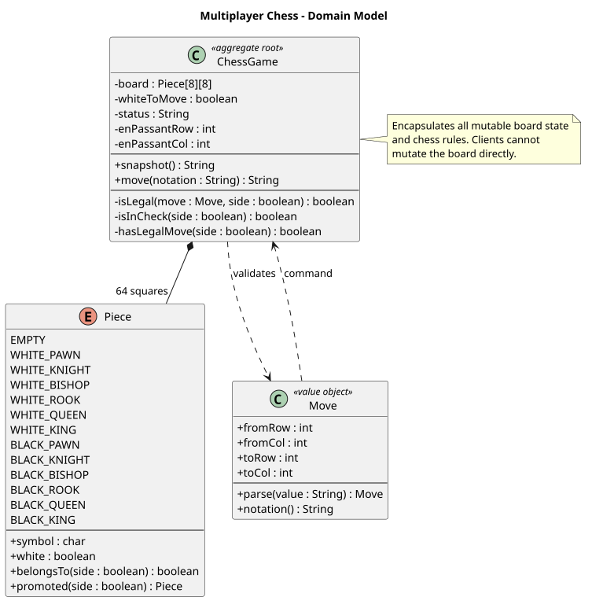
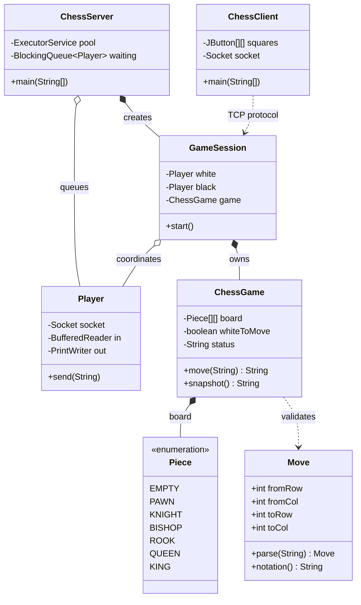
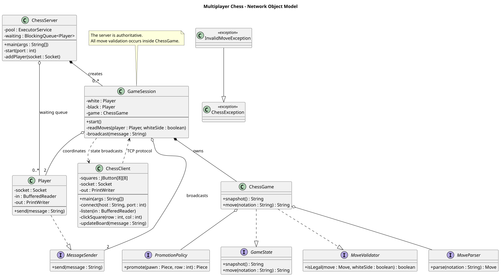
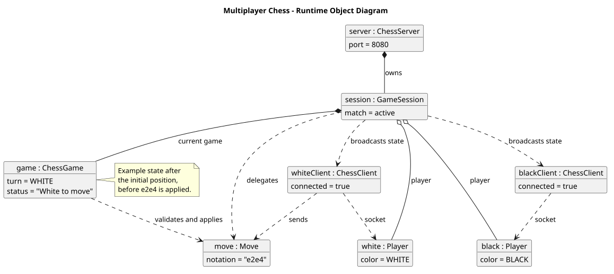
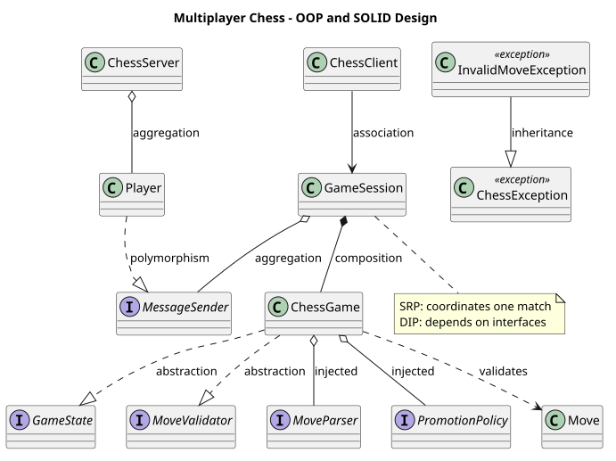
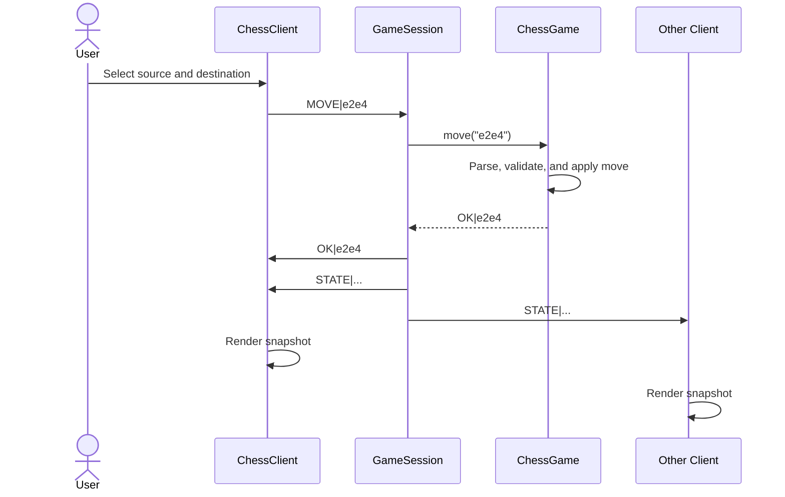

# Object-Oriented Methodology

## 1. Purpose and scope

This document describes the analysis, design, and implementation of the multiplayer
chess system using an object-oriented methodology. The design separates:

1. **Domain responsibilities**: chess pieces, moves, board state, and rules.
2. **Application responsibilities**: pairing players and managing a game session.
3. **Presentation and infrastructure responsibilities**: Swing rendering and TCP I/O.

The server is authoritative: clients request moves, but only `ChessGame` can accept
and apply a move.

## 2. Requirements analysis

### Functional requirements

- Pair exactly two connected players.
- Assign White to the first player and Black to the second.
- Display the current board to both players.
- Accept moves using coordinate notation such as `e2e4`.
- Reject malformed, out-of-turn, unauthorized, or illegal moves.
- Support check, checkmate, stalemate, castling, en passant, and promotion.
- Broadcast the updated state after every accepted move.
- Notify a player when the opponent disconnects.

### Non-functional requirements

- Use Java 17 or newer.
- Keep the game state authoritative and serialized on the server.
- Keep the core game rules independent of Swing and socket implementation details.
- Use only the Java standard library.
- Protect mutable state with encapsulation and synchronization.

## 3. Object-oriented analysis

### Primary objects

| Object | Responsibility | Collaborators |
|---|---|---|
| `ChessGame` | Owns board state, turn state, special-move state, and rule validation | `Piece`, `Move` |
| `Piece` | Represents a chess piece type, color, and symbol | `ChessGame` |
| `Move` | Immutable value object for source and destination squares | `ChessGame` |
| `ChessServer` | Accepts TCP connections and pairs waiting players | `Player`, `GameSession` |
| `GameSession` | Coordinates one match and serializes move requests | `ChessGame`, `Player` |
| `Player` | Encapsulates a client's socket and streams | `GameSession` |
| `ChessClient` | Presents the board and translates clicks into commands | `Socket`, Swing components |

### Use cases

#### Start a game

1. A client connects to `ChessServer`.
2. The server creates a `Player` object.
3. The first player is placed in the waiting queue.
4. The next player is paired with the waiting player.
5. `GameSession` assigns colors and sends an initial `ChessGame` snapshot.

#### Make a move

1. `ChessClient` converts two selected squares into a `MOVE|e2e4` command.
2. `GameSession` identifies the sending player's color.
3. `ChessGame.move()` parses and validates the move.
4. `ChessGame` applies the move and updates the game status.
5. `GameSession` broadcasts the new `ChessGame.snapshot()` to both players.

## 4. Object-oriented design

### Classes, objects, and attributes

The source code demonstrates the distinction between a class and its runtime
objects:

- `ChessGame`, `ChessServer`, `GameSession`, `Player`, `Move`, and `ChessClient`
  are classes that define behavior and state.
- At runtime, `new ChessGame()` creates a game object, `new Player(socket)` creates
  player objects, and `new GameSession(white, black)` creates a match object.
- Attributes include `ChessGame.board`, `ChessGame.whiteToMove`, `Player.socket`,
  `GameSession.participants`, and the immutable `Move` coordinates.

### Abstraction

The project uses interfaces to expose stable contracts while hiding implementation:

- `GameState` abstracts snapshot and move operations.
- `MoveValidator` abstracts legal-move validation.
- `MessageSender` abstracts delivery of protocol messages.
- `MoveParser` abstracts input syntax.
- `PromotionPolicy` abstracts the promotion rule; the default
  `QueenPromotionPolicy` can be replaced without editing `ChessGame`.

`GameSession` works with `GameState` and broadcasts through `MessageSender`, so
the networking and rules implementation can be replaced without changing the
session's coordination logic.

### Encapsulation

- `ChessGame.board` and all turn/rule state are private.
- Clients cannot mutate the board; they can only request a move.
- `ChessGame` exposes the narrow operations `move()` and `snapshot()`.
- `Player` hides the socket streams behind `send()`.

### Abstraction

- `Move` hides coordinate-to-array conversion and provides domain notation.
- `Piece` hides piece symbols, color checks, and promotion behavior.
- `ChessGame` hides the algorithms for path checking, attacks, checks, and legal moves.
- `ChessClient` hides TCP message handling from the Swing event handlers.

### Composition

The system favors composition over a large inheritance hierarchy:

- A `GameSession` **has** one `ChessGame`.
- A `GameSession` **has** two `Player` objects.
- A `ChessGame` **has** an 8x8 collection of `Piece` values.
- A `ChessClient` **has** Swing controls and a network connection.

This keeps the rules engine independent from the transport and user interface.

### Polymorphism

`ChessGame` is used through the `GameState` and `MoveValidator` interfaces.
`Player` is used through the `MessageSender` interface when a session broadcasts
to its participants. `Piece` is an enum-based domain abstraction that supplies
common operations such as `belongsTo()`, `isEmpty()`, and `promoted()`.

### Exception handling

Invalid domain input is represented explicitly:

- `ChessException` is the domain exception base class.
- `InvalidMoveException` reports malformed coordinate notation.
- `ChessGame.move()` catches domain exceptions and returns the protocol-level
  `ERROR|...` response without mutating the board.
- The server handles `IOException` at connection boundaries and closes sockets
  in `finally` blocks.

This separates expected user errors from transport failures and prevents invalid
requests from becoming partially applied state changes.

### Relationships between classes

The diagrams demonstrate three required relationship types:

- **Association**: `ChessClient` communicates with `GameSession` through TCP;
  `GameSession` also coordinates `Player` objects.
- **Aggregation**: `ChessServer` keeps a waiting collection of `Player` objects;
  players can exist independently of a completed game session.
- **Composition**: `GameSession` owns its `ChessGame`; the game state is created
  for that match and is not shared between sessions. `ChessGame` also composes
  its board state.

### SOLID principles

| Principle | Demonstration |
|---|---|
| Single Responsibility | `ChessGame` handles rules, `GameSession` handles match coordination, `Player` handles a connection, and `ChessClient` handles presentation. |
| Open/Closed | `GameState`, `MoveValidator`, and `MessageSender` allow alternate implementations without changing their consumers. |
| Liskov Substitution | Any implementation of `GameState` can be supplied to `GameSession`; any `MessageSender` can receive broadcasts. |
| Interface Segregation | Interfaces are small and focused: state, validation, and message delivery are separate contracts. |
| Dependency Inversion | `GameSession` depends on `GameState` and `MessageSender`; `ChessGame` depends on `MoveParser` and `PromotionPolicy` abstractions rather than hard-coding every policy. |

### Modularity and software design

The package is modular by responsibility:

```text
chess/
  domain       Move, Piece, ChessGame, GameState, MoveValidator, MoveParser,
               PromotionPolicy, and exceptions
  server       ChessServer, GameSession, Player, MessageSender
  client       ChessClient
```

The current Java package is intentionally flat for simple execution, but the
classes already follow these module boundaries. The design supports extracting
the domain, server, and client into separate packages or modules later without
changing the protocol contracts.

The main design decisions are:

1. Keep the server authoritative to prevent clients from mutating state.
2. Keep the domain independent from Swing and TCP.
3. Use composition and focused interfaces instead of inheritance-heavy piece classes.
4. Convert domain exceptions into explicit protocol errors at the application boundary.

The constructors `ChessGame(MoveParser, PromotionPolicy)` and
`GameSession(Player, Player, GameState)` are explicit dependency injection points.
Tests or future variants can provide another notation parser, promotion policy, or
game-state implementation while the coordinating classes remain unchanged.

### Inheritance

Inheritance is deliberately limited to framework integration rather than used for
the chess rules. `ChessServer` and `ChessClient` are final because the application
does not require substitutable server or client subclasses. This avoids artificial
piece subclasses and keeps the model compact.

## 5. Class relationship diagram

The same class model is maintained as PlantUML source and rendered SVG:

- [Chess domain PlantUML source](plantuml/chess-domain.puml)
- [Chess domain class diagram (SVG)](chess-domain.svg)
- [Chess network PlantUML source](plantuml/chess-network.puml)
- [Chess network class diagram (SVG)](chess-network.svg)
- [Chess runtime object PlantUML source](plantuml/chess-objects.puml)
- [Chess runtime object diagram (SVG)](chess-objects.svg)
- [OOP and SOLID design PlantUML source](plantuml/chess-design.puml)
- [OOP and SOLID design diagram (SVG)](chess-design.svg)











## 6. Sequence of a valid move



## 7. State and concurrency design

`ChessGame` is the aggregate root for one match. `GameSession` synchronizes access
to its `ChessGame` before checking the turn and applying a move. This makes validation
and mutation one critical section, preventing two simultaneous requests from both
being accepted for the same turn.

The Swing client updates controls on the Swing event dispatch thread. Network
messages are read on a daemon listener thread and then scheduled onto the Swing
thread for rendering.

## 8. Design validation

The design is validated by:

- Compiling all production classes with `javac`.
- Exercising legal and illegal moves through `ChessGame`.
- Running a TCP integration check with two clients.
- Confirming that accepted moves produce synchronized snapshots for both players.

## 9. Extension points

The current responsibilities make future changes localized:

- Add clocks as a `GameClock` collaborator of `GameSession`.
- Add usernames by extending `Player` without exposing socket details.
- Add persistence through a `GameRepository` abstraction.
- Add rooms by introducing a `GameLobby` that creates `GameSession` objects.
- Add promotion selection by extending the move protocol and `Move`.
